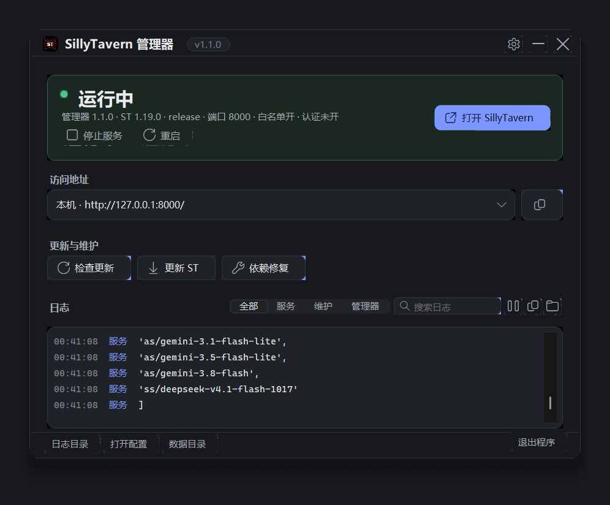
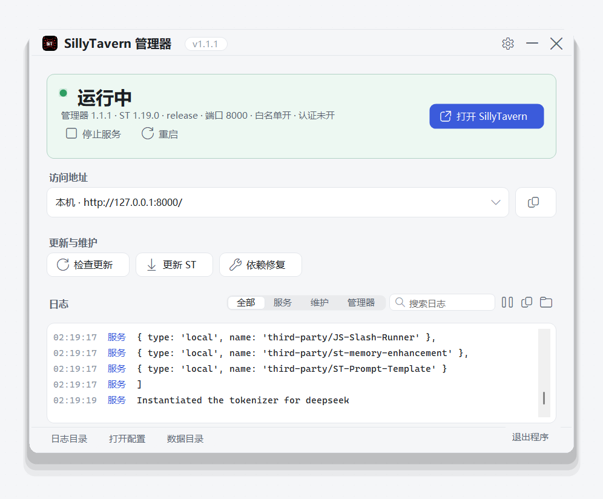
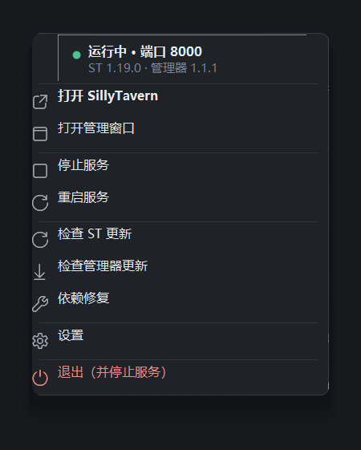
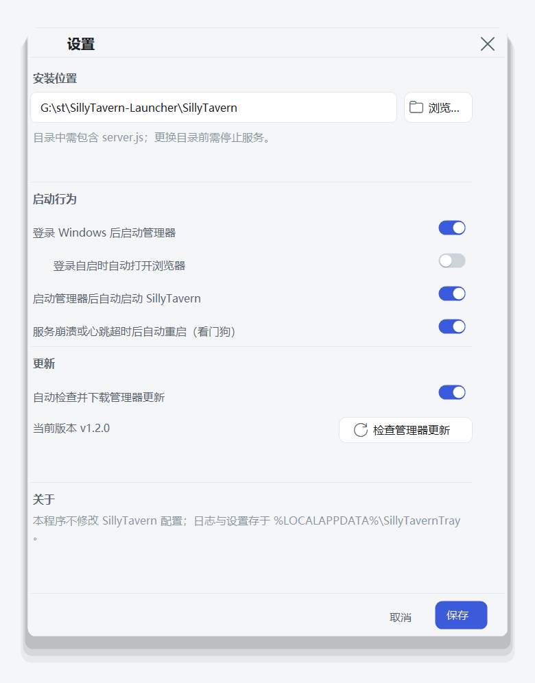

<p align="center">
  
</p>

<h1 align="center">SillyTavern 托盘管理器</h1>

<p align="center">
  <b>让 SillyTavern 安静地待在后台：托盘启动/停止、开机自启、一键更新、日志随手看。</b>
</p>

<p align="center">
  <a href="https://github.com/wacilimonster-source/SillyTavernDesktop/releases/latest"></a>
  <a href="https://github.com/wacilimonster-source/SillyTavernDesktop/releases"></a>
  <a href="LICENSE"></a>
  <a href="https://github.com/wacilimonster-source/SillyTavernDesktop/actions/workflows/release.yml"></a>
  
  
  
</p>

## 它解决什么问题

SillyTavern 很好用，但每天的开场白通常是：打开文件夹、找启动脚本、等终端跑起来、不小心关掉窗口、再重来一遍。

这个托盘管理器只做一件事：**把 SillyTavern 变成一个安静的后台服务**。它不替代 SillyTavern 的网页，也不接管你的配置，只把启动、停止、更新、看日志这些琐事收进一个托盘图标。

- 开机后自动在后台就绪，双击托盘就能看状态。
- 不用记 git/npm 命令，更新和依赖修复点一下就好。
- 关掉窗口不会关掉服务；想退出时再明确退出。
- 出问题时，日志、状态和下一步操作都在同一个窗口里。

## 功能

- **托盘常驻**：双击打开管理窗口；右键菜单直接启动/停止/重启、打开 SillyTavern、检查更新、退出。
- **状态一眼可见**：运行中 / 已停止 / 正在启动 / 端口占用 / 异常退出 / 未配置，各有明确文案和主操作。
- **一键打开与复制**：自动列出本机和局域网访问地址，复制即可分享。
- **更新与维护**：检查 ST 更新、执行官方 Git/npm 更新、依赖修复；更新前预检，失败保留日志，不强制重置。
- **日志面板**：来源筛选、搜索、向上滚动自动暂停、回到底部、复制、打开日志目录。
- **看门狗**：通过官方 heartbeat 检测卡死；服务崩溃或心跳超时自动重启（最多 3 次 / 10 分钟，可在设置中关闭）。心跳看门狗需要 SillyTavern 1.16+；更早版本仍会在进程退出后自动重启。
- **登录自启**：可选登录 Windows 后启动管理器，以及随后启动 ST / 打开浏览器。
- **管理器自更新**：从本仓库正式 Release 检查、下载并校验 SHA-256，退出后安装。
- **原生质感**：Windows 11 圆角、Fluent 图标、浅色/深色主题、125%–200% DPI。

## 界面

<p align="center">
  
  
</p>

<p align="center">
  
  
</p>

## 快速开始

1. 从 [Releases](https://github.com/wacilimonster-source/SillyTavernDesktop/releases/latest) 下载 `SillyTavernTray-win-x64.exe`，双击运行。自包含单文件，不需要另外安装 .NET。
2. 程序会尝试查找已有 SillyTavern；找不到时，在设置里选择包含 `server.js` 的目录。服务以 `node server.js --listen` 的方式后台启动。
3. 需要登录自启时，在设置中勾选“登录 Windows 后启动管理器”。只作用于当前 Windows 用户。
4. 更新与依赖修复使用电脑已有的 Git、npm 和 Node.js，可能需要网络。

> 端口 8000 被占用时，说明可能已有另一个实例在运行。请先自行停止原有实例；管理器不会结束或接管不是它启动的进程。

## 系统要求

- Windows 10 / 11 x64
- 已有一个 SillyTavern 安装（本程序不包含 SillyTavern 本体）
- Node.js（运行 ST）；Git 与 npm（更新与依赖修复）
- 心跳看门狗需要 SillyTavern 1.16 或更新版本；更早版本仍支持崩溃自动重启

## 它不会做什么

- **不修改** SillyTavern 的配置、白名单或认证；默认保留你现有的设置。
- **不接管** 不是它启动的进程；不会为了启动而结束别的程序。
- **不上传** 日志或聊天数据；日志只在本机 `%LOCALAPPDATA%\SillyTavernTray\logs\`。
- **不强制** 更新：预检发现本地修改会停止流程；失败保留日志并保持服务停止，不自动重置或回退。
- 代理设置只传给本次 Git/npm 子进程，不修改 Windows、Git 或 npm 的持久配置；SSH 远端仍按 SSH 自身配置连接。

## 常见问题

**关掉管理窗口，服务会停吗？**  
不会。点关闭或最小化只是收进托盘；要停止服务，请用“停止服务”或托盘里的“退出并停止服务”。

**服务卡死了怎么办？**  
管理器默认开启看门狗：通过官方 heartbeat 检测，崩溃或心跳超时后自动重启；如果关闭了该选项，可在设置中重新开启。

**为什么显示“端口 8000 被占用”？**  
已有实例占用了端口。请先停止那个实例，再点“重新检测”或“启动服务”。

**局域网设备访问不了？**  
检查 SillyTavern 的白名单、认证配置和 Windows 防火墙。管理器不会修改这些设置。

**更新失败了怎么办？**  
打开日志查看具体报错。管理器在失败时不会强制覆盖本地修改，也不会自动回滚；确认问题后重新执行即可。

**需要安装 .NET 吗？**  
不需要。发布的是自包含单文件；但运行 SillyTavern 本身仍需要 Node.js。

## 开发与构建

项目使用 .NET 10 Windows 桌面框架和 .NET 10 SDK。

```powershell
dotnet run --project 'tests\TraySmokeTests\TraySmokeTests.csproj' -c Release
dotnet publish 'SillyTavernTray.csproj' -c Release -r win-x64 --self-contained true -p:PublishSingleFile=true -o 'publish\win-x64'
```

发布文件是自包含的 Windows x64 程序，不要求目标电脑另行安装 .NET；仍需要可用的 Node.js、npm 和 Git。测试使用临时目录、临时 Git 仓库和隔离的注册表键，不操作实际 SillyTavern 安装或真正的登录启动项。

发布新版本时，先在 `CHANGELOG.md` 写入对应版本的小节（发布说明会据此生成），再更新 `SillyTavernTray.csproj` 的 `Version`、提交并推送，最后创建并推送匹配的 `v版本号` 标签。GitHub Actions 会构建并发布 Windows x64 程序，发布说明由 `CHANGELOG.md` 对应小节和 `.github/release-notes-*.md` 自动生成。自动更新只读取正式 Release，要求资产名为 `SillyTavernTray-win-x64.exe`，并校验 GitHub 提供的资产 SHA-256。

## English

A lightweight Windows tray manager for SillyTavern. It starts/stops/restarts your existing install, opens the web UI, copies LAN addresses, runs the official Git/npm update and dependency repair, and keeps logs in one place — without modifying your SillyTavern configuration or taking over processes it did not start. Self-contained single-file build; light/dark Windows 11-style UI.

## 许可证

本项目以 [MIT License](LICENSE) 发布。

## 致谢

程序图标取自 [SillyTavern Launcher](https://github.com/SillyTavern/SillyTavern-Launcher)，其许可见 [assets/SillyTavern-Launcher-LICENSE.txt](assets/SillyTavern-Launcher-LICENSE.txt)。

如果这个项目帮你省下了每天找启动脚本的时间，欢迎点一个 ⭐。
